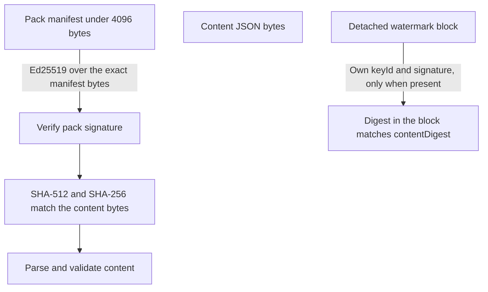

# Rule-pack format, version 1

**Status: draft — not accepted.** This specification is an AI draft for the owner to review and approve (rule 15 of `AGENTS.md`). It records as decided the two recommendations the owner accepted on 1 November 2026 (IQ-14, the structured shape, and IQ-36, dated pack lines with content-addressed bytes and a detached watermark), and it records the test-only approval of `JsonSchema.Net`. Nothing in this document is final, accepted or approved until the owner says so.

This document is the written contract for work package P0-03 ([issue #2](https://github.com/inveniotech/gate-keeper/issues/2)). It does not implement the loader or the matcher; those are P1-03 and P1-06. The public JSON Schema that validates the content document is [`schemas/rulepack.schema.json`](../../schemas/rulepack.schema.json). Example packs are in [`docs/specs/examples/rule-pack/`](examples/rule-pack/).

---

## 0. Document status

### 0.1 Decision status

Normative text in this specification comes from the recorded decisions listed here. The specification itself stays a draft, because rule 15 reserves final approval of specifications to the owner.

| Identifier | Status | What it settles |
|---|---|---|
| IQ-06, IQ-07 | Decided | Separate pack-signing key and `keyId`; verify the signature, then the content digest, then parse. The signed bytes are a small manifest (at most 4,096 bytes) that carries a SHA-512 digest of the content bytes. Pre-hashed Ed25519 is not used. |
| IQ-12 | Decided | Context-anchored BVN and NIN rules, NUBAN where a check digit exists, confidence tiers, and the generic `pii.ng-11-digit-id` note. |
| IQ-14 | **Accepted by the owner, 1 November 2026** | The structured shape in section 7, enforced by every engine. Origin: the 29 October proposal. |
| IQ-22 | Decided | `severity` is `error`, `warning` or `note`. |
| IQ-23 | Decided | `profiles` is `default`, `deep`, or both; omitted means both. |
| IQ-24 | Decided | Same pack, newer version wins as a whole; different packs with the same rule identifier is a load error; `minEngineVersion` is mandatory; disabling a rule needs a reason, which is configuration (P0-05), not pack content. |
| IQ-25 | Decided | Unsigned local packs use rule identifiers starting with `local.` and cannot override an Invenio rule; provenance is `bundled`, `plan-gated` or `local`. |
| IQ-26 | Decided | The 90-day staleness warning uses whole civil days, so a timezone cannot flip the warning. |
| IQ-27 | Decided | Gate-Keeper scans offline and has no refresh channel. |
| IQ-35 | Decided | The SHA-512 digest inside the manifest is the integrity check. |
| IQ-36 | **Accepted by the owner, 1 November 2026** | Dated pack lines, content-addressed bytes and the detached watermark in sections 3 and 9. Origin: the 29 October proposal. |
| IQ-64 | Decided | Secret-like strings stay out of the format. |
| IQ-76 | Decided | `redaction.optional` defaults to false; only a pack may set it true. |
| IQ-80 | Decided | `contentDigest` is lowercase-hex SHA-256 of the content bytes. |
| IQ-82 | Decided | The optional `processor` block: `dataCategories` and `usualRegion`. Catalogue findings are data, not an engine special case. |
| P0-16 | Decided | The spike report [`spikes/aot/report.md`](../../spikes/aot/report.md) measured `RegexOptions.NonBacktracking` inside the per-file budget and is the input this card depends on. |

The register entry recording IQ-14 and IQ-36 as decided is an owner task. This specification cites the identifier; it does not write down the register location, because no public document may describe or link to a private repository (rule 29).

### 0.2 Normative keywords

The key words **MUST**, **MUST NOT**, **REQUIRED**, **SHALL**, **SHALL NOT**, **SHOULD**, **SHOULD NOT** and **MAY** are to be interpreted as described in RFC 2119. When this document writes "the schema", it means [`schemas/rulepack.schema.json`](../../schemas/rulepack.schema.json). When it writes "the loader", it means the pack-loading step implemented in P1-03.

### 0.3 Change log

| Version | Date | Change |
|---|---|---|
| 1 (draft) | 1 November 2026 | First draft. |

---

## 1. Scope and non-goals

### 1.1 In scope

The bytes and the fields of a rule pack: the content document, the signed manifest, and the detached watermark. The rules each author follows to produce bytes a verifier can hash without re-serialising. The structured shape a matcher executes (IQ-14). The version scheme and the pack line (IQ-36).

### 1.2 Not in scope

- The loader, the matcher, the signature implementation and the corpus cases (P1-02 onwards).
- Real NDPA or GAID citations (P2-02, human approval).
- Marking this specification accepted, writing ADR E-002, or updating the commercial status table.
- The pack-diff check that a correction adds no rule identifier, and the cross-stack conformance vectors.
- A regular-expression denial-of-service checker. The shape bounds in section 7 are the safety control.

---

## 2. Byte layout

A released Invenio pack is three byte sequences: the **content bytes**, the **manifest**, and, when a product requires one, a detached **watermark**. Two copies of one release share one content digest, because the watermark and the generation metadata are outside the content bytes.



### 2.1 Content bytes

The content bytes are the pack body: UTF-8, no byte-order mark, LF line endings, a trailing newline, and object keys sorted at every level. Producers emit exactly those bytes; verifiers hash them and do not re-serialise. The watermark and `generatedAt` are not in this document, so two copies of one release share one `contentDigest`. The producer profile (sorted keys, LF, a trailing newline) is a continuous-integration requirement; RFC 8785 canonicalisation stays out, for the same reason it was rejected for licence tokens.

`contentDigest` is the lowercase-hex SHA-256 of the content bytes (IQ-80). Evidence later records this digest over content that excludes the watermark and generation metadata (IQ-80); this specification defines that digest.

### 2.2 Manifest

The manifest is a single-line JSON document carried inside ASCII armour, signed over its exact bytes (IQ-07). It carries `keyId` (in the armour header and in the payload; they MUST match), `packId`, `version`, and `contentHashes` with SHA-256 and SHA-512 of the same content bytes.

- SHA-256 is the `contentDigest` evidence records (IQ-80).
- SHA-512 is the integrity check inside the manifest (IQ-35).
- One byte sequence, two algorithms, so the two hashes stay tied together.

The manifest MUST be at most 4,096 bytes, because AWS KMS pure Ed25519 signs at most 4,096 bytes.

The armour labels are:

```
-----BEGIN GATE-KEEPER RULE PACK MANIFEST-----
Key-Id: <keyId>
<manifest JSON, single line>
-----END GATE-KEEPER RULE PACK MANIFEST-----
```

The manifest JSON is a single line with no whitespace, in this exact field order:

```
{"keyId":"<keyId>","packId":"<packId>","version":"<version>","contentHashes":{"sha256":"<sha256>","sha512":"<sha512>"}}
```

The signature covers the exact bytes of that payload line. A verifier strips a trailing carriage return from each armour line before it verifies, and it MUST check that the armour `Key-Id` header and the manifest `keyId` agree. The manifest schema is the `manifest` definition in `schemas/rulepack.schema.json`, a second root in the same file. `packId` and `version` in the manifest MUST equal `id` and `version` in the content document.

### 2.3 Watermark

The watermark (`organisationName`, `licenceId`, `generatedAt`) is a detached block with its own armour, its own `keyId`, and a copy of `contentDigest`. It is absent from the content bytes and from the pack manifest, so every issued copy of one release shares one pack signature and one digest. This matches OCI referrers: extra metadata hangs off a digest, and the blob stays shared.

The block is checked with a different embedded public key to the pack-signing key. The pack key attests the rules; the detached block is checked separately. The armour labels are:

```
-----BEGIN GATE-KEEPER RULE PACK WATERMARK-----
Key-Id: <keyId>
<watermark JSON, single line>
-----END GATE-KEEPER RULE PACK WATERMARK-----
```

The watermark JSON is a single line with no whitespace, in this exact field order:

```
{"keyId":"<keyId>","contentDigest":"<contentDigest>","organisationName":"<organisationName>","licenceId":"<licenceId>","generatedAt":"<generatedAt>"}
```

`generatedAt` is an instant in UTC, written `YYYY-MM-DDThh:mm:ssZ`. It records when a copy was produced; it is outside staleness and outside coverage.

This specification defines the bytes and the check. It does not say when a product requires the block. If the block is present, its signature MUST verify and its `contentDigest` MUST match before the content is trusted. If it is absent, the pack signature is sufficient for rule integrity. The signature on a pack has no expiry; a verifier does not fail because a pack is old (IQ-36).

---

## 3. Content document

The content document is the JSON object the schema validates. Its top-level fields are:

| Field | Type | Required | Notes |
|---|---|---|---|
| `schemaVersion` | integer | yes | MUST be `1`. |
| `id` | string | yes | The pack identifier. |
| `version` | string or integer | yes | A calendar version for an Invenio pack, a positive integer for a local pack (section 9). |
| `provenance` | string | yes | `bundled`, `plan-gated` or `local` (IQ-25). |
| `minEngineVersion` | string | yes | The oldest engine that may load this pack, as a semantic version `major.minor.patch`. |
| `rules` | array | yes | At least one rule (section 4). |
| `coverageDate` | string | Invenio only | A civil date `YYYY-MM-DD` (section 9). |
| `contentIssuedAt` | string | Invenio only | A civil date `YYYY-MM-DD` (section 9). |
| `baseVersion` | string | Invenio corrections only | The line's `.0` version, `YYYY.MM.0` (section 9). |

An Invenio pack carries `coverageDate` and `contentIssuedAt`, and, on a correction, `baseVersion`. A local pack carries none of those three, and its `version` is a positive integer. The schema encodes this split with two alternatives selected on `provenance`.

When two copies of the same pack `id` are loaded, the greater version wins as a whole (IQ-24). Two different packs with the same rule identifier is a load error (IQ-24). `minEngineVersion` is mandatory, and a loader MUST refuse a pack whose `minEngineVersion` is newer than the engine.

---

## 4. Rules

Each element of `rules` is one detection rule.

| Field | Type | Required | Notes |
|---|---|---|---|
| `id` | string | yes | Dotted lowercase (`pii.bvn.log`). Local identifiers start with `local.` and nothing else may (section 9). |
| `severity` | string | yes | `error`, `warning` or `note` (IQ-22). |
| `category` | string | yes | A free string, not a closed list, so a new category is data (NFR-027). |
| `citation` | object | yes | `title` (required) plus optional `ndpa` and `gaid` section strings. |
| `sinceVersion` | string or integer | yes | The pack version from which this rule takes effect; it mirrors the pack `version` form. |
| `redaction` | object | no | `optional` (boolean, default `false`). |
| `profiles` | array | no | `default`, `deep`, or both; omitted means both (IQ-23). |
| `suppressionHints` | array | no | Plain strings for help text; not executable. |
| `processor` | object | no | `dataCategories` (string array) and `usualRegion` (IQ-82). |
| `matcher` | object | yes | Exactly one kind: `pattern` or `list` (section 5). |

`redaction.optional` defaults to `false`. Only a pack may set it `true` (IQ-76); switching a rule off for redaction is start-up configuration by rule identifier, and it is only permitted for rules the pack marks optional.

`citation.title` MUST be present. `citation.ndpa` and `citation.gaid` are optional strings. This specification does not invent a citation; the examples use an obvious placeholder title, and production wording waits for P2-02 (rule 15).

A `suppressionHints` entry is help text shown to a user. It MUST NOT be interpreted by the engine as an instruction.

The `processor` block records which data categories a processor handles and the region where it usually operates. A finding from such a rule is catalogue data, not an engine special case (IQ-82).

---

## 5. Matchers

A rule has exactly one matcher.

### 5.1 Pattern matcher

| Field | Type | Required | Notes |
|---|---|---|---|
| `shape` | array | yes | The structured shape (section 7). |
| `validator` | object | no | A named validator (section 8). |
| `boundary` | string | yes | `none`, `digit` or `alnum`. |
| `keywords` | array | no | The literal prefilter (section 7.4). |
| `window` | integer | no | The prefilter window in scalar values; at most 4,096 (section 7.4). |
| `location` | object | no | `kind` plus path globs (section 5.3). |
| `exclusions` | array | no | Named exclusions (section 8). |
| `excludePrefixes` | array | no | Prefixes that void a match (section 8). |
| `excludeValues` | array | no | Exact values that void a match (section 8). |

`boundary` is one of `none`, `digit` or `alnum`. It is a field, not a look-around: the shape language has no place to write a zero-width assertion.

### 5.2 List matcher

The list matcher holds exact `package` and `hostname` entries as pack data, in two arrays. At least one of the two arrays MUST be present. A shorter entry MUST NOT match inside a longer token; that rule is stated here in prose and implemented by the P2-12 catalogue matcher.

### 5.3 Location

`location.kind` is the closed inventory set from P0-04: `log`, `migration`, `api-model`, `configuration`, `fixture` or `source`. `location.paths` is a list of path globs in a closed subset: literal segments, `*`, and `**`, forward slashes only, relative to the repository root. The glob language contains no other metacharacter — no `?`, character classes, or brace expansions.

---

## 6. Security and determinism rules for producers

- Content bytes MUST be UTF-8 without a byte-order mark, with LF line endings and a trailing newline.
- Object keys MUST be sorted at every level, so two producers emit the same bytes for the same pack.
- A verifier hashes the exact bytes it received and never re-serialises a document, so a producer that re-orders keys produces a different `contentDigest` (IQ-07).
- No pack field carries a matched value, a real identifier, or a secret-like string (IQ-64, rule 10).

---

## 7. The structured shape (IQ-14)

There is no regular-expression string in a pack. A rule carries a `shape`: a JSON array of parts. This follows the engines that refuse back-references and look-around at the place the pattern runs — Google RE2, Rust's `regex` crate, and .NET `NonBacktracking`, which the P0-16 spike already measured. A hostile pattern must fail at load time, not in production logs, so the control sits in every adapter, not in a CI lint that cannot see customer local packs (IQ-25).

### 7.1 Parts

Each part is one atom with repetition bounds:

- `literal` — a literal ASCII string.
- `class` — `digit` or `alnum`.
- `ranges` — an explicit list of ASCII ranges, each a two-element `[low, high]` pair.
- `oneOf` — an alternation of literal strings.

`min` and `max` are the repetition bounds, in scalar values. `max` MUST be at most 64. The shape MUST have at most 32 parts. At most one part has `emit: true`, and that part's span is the finding span used for redaction. A part that carries `oneOf` is an alternation and MUST NOT repeat, so its `max` MUST be 1; this removes the ambiguous-alternation case, so each adapter implements one forward scan with a fixed bound.

The maximum number of scalar values a shape can consume — the sum, over every part, of that part's `max` times the width of its atom (1 for `class` and `ranges`, the literal length for `literal` and `oneOf`) — MUST NOT exceed 256. The schema enforces the per-part bound, the part count and the single `emit`; the sum bound and the `min` not exceeding `max` rule are load-time checks (P1-03), because JSON Schema cannot sum across array items.

### 7.2 ASCII only

Literals, `oneOf` entries and keywords are ASCII. Case folding for keywords and literals is ASCII A–Z only, defined here once: an engine folds `A`–`Z` to `a`–`z` and leaves every other scalar value alone. Unicode case folding stays out, because the engines disagree on it.

### 7.3 What the shape cannot express

The schema has nowhere to put a dot, a negated class, `\d`, `\w`, `\s`, `\b`, an anchor, a look-around, a back-reference, a flag or a named group. The structure itself excludes them.

### 7.4 Keywords and the window

Keywords stay a separate list from the shape. They are the literal prefilter: when `keywords` is present, the engine looks for a keyword before it runs the shape, and only inside `window`. `window` is the maximum number of scalar values that may separate a matched keyword from the start of the shape match, and it MUST be at most 4,096.

### 7.5 Indexes and the resume rule

Input is a sequence of Unicode scalar values. Indexes, windows and the 64 KiB middleware cap are counted in scalar values, so a match never splits a character and the four languages agree on positions. `boundary` is a field (`none`, `digit`, `alnum`). The resume rule is: a rejected match resumes at match start plus one scalar value; an accepted match resumes at match end. This is what stops a 12-digit run from hiding an 11-digit value. P1-06 implements the search; P3-00 carries the vectors.

### 7.6 Equivalence

Every allowed shape is a regular language inside the October profile, and the P0-16 `NonBacktracking` measurements still apply to that language. .NET MAY use `NonBacktracking` as its implementation. The other adapters implement the shape directly, so they do not call the host backtracking engine and do not take a native RE2 dependency (rule 8, and the middleware zero-dependency rule).

---

## 8. Named validators and exclusions

### 8.1 Validators

A named validator is a closed set. A new name is an engine capability under rule 9, and needs a schema change plus `minEngineVersion`.

| Name | Pack data |
|---|---|
| `digits-length` | `length` — the exact digit count. |
| `nuban` | none (the check digit is engine logic). |
| `ng-phone-prefix` | `prefixes` — the allowed leading prefixes. |
| `email-not-example-domain` | none. |

`digits-length` and `ng-phone-prefix` carry their parameters as pack data, so the engine capability stays generic and the rule stays data.

### 8.2 Exclusions

Named exclusions are a closed set, expressed as pack data (IQ-12 option C):

- `repeated-digits`, `sequential-digits`, `hex-fragment`, `uuid-fragment`, `version-string`, `date-or-timestamp`.

`excludePrefixes` and `excludeValues` are additional lists. A match that any exclusion applies to is discarded. Digit and letter boundaries stay the `boundary` field, not a look-around.

---

## 9. Pack lines, versions and dates (IQ-36)

An Invenio pack version is `YYYY.MM.P`. `P = 0` opens a line; `P > 0` is a correction on that line. Precedence is the numeric triple (year, month, patch) compared as integers — string sort is wrong for `2027.9` and `2027.10`, so this comparison is written down. When two copies of the same pack id are loaded, the greater triple wins as a whole (IQ-24). Dates are facts about the line; they do not break a tie.

`coverageDate` and `contentIssuedAt` are civil dates, `YYYY-MM-DD`, with no time of day. For `P = 0` they are equal. For a correction, `coverageDate` MUST be on or before `contentIssuedAt`. The loader checks that consistency on the signed content.

Coverage comparisons use `coverageDate`. The 90-day staleness warning (IQ-26) uses whole civil days of `evaluatedOn` minus `contentIssuedAt`, so a timezone cannot flip the warning. Staleness is a warning; the signature has no expiry and verification does not fail because a pack is old.

A correction carries the same rule identifiers as its line, or a subset. The signed content records `baseVersion` (the line's `.0`) so the claim travels with the bytes. The loader checks that a correction's `baseVersion` has the same year and month as its `version` and patch 0. It cannot, on its own, prove the identifier set matches the parent pack; the release CI diff is that enforcement, and it remains a later card.

Local packs (IQ-25) use a positive-integer `version` and omit `coverageDate` and `contentIssuedAt`. They are not lines, and a calendar version would only invent a month.

---

## 10. Provenance and local packs (IQ-25)

`provenance` is one of `bundled` (embedded in the free installation), `plan-gated` (embedded in the paid installation media) or `local` (an unsigned pack the customer authors). A local pack's rule identifiers MUST start with `local.` and MUST NOT override an Invenio rule. Nothing else may start with `local.`.

---

## 11. NFR-027 mapping

New detection logic ships as rule-pack JSON with a citation and corpus cases, never as engine code. This section maps each Phase 2 category to the fields already in this schema, demonstrating that a new rule in those categories is pack data.

| Category | Fields used |
|---|---|
| BVN | A context-anchored digit rule: `keywords` for the anchor, a `digit` shape, and `digits-length` or the shape bounds for the length. |
| NIN | As BVN, with its own `category` and `citation`. |
| Field-without-value | A rule whose `keywords` name the field and whose shape matches the empty or missing value form. |
| NUBAN | A digit shape plus the `nuban` validator, where a check digit exists. |
| Phone | A digit shape plus the `ng-phone-prefix` validator, with the prefix list as pack data. |
| Email | A shape for the address plus the `email-not-example-domain` validator. |
| Location heuristics | `location.kind` and `location.paths` on the relevant rules. |
| Processor catalogue | The `processor` block, and the `list` matcher for package and hostname entries. |
| Reserved `consent.missing` | A reserved rule identifier and category; no detection is defined in this specification. |

The generic `pii.ng-11-digit-id` note (IQ-12) is a confidence-tier rule: it flags an 11-digit run and leaves the specific BVN or NIN determination to the context-anchored rules.

---

## 12. Open questions and deferred items

- The `window` upper bound (4,096 scalar values), the glob grammar, the validator parameter shapes (`length`, `prefixes`), and the armour `Key-Id` header name are draft decisions in this document for the owner to confirm.
- Recording IQ-14 and IQ-36 as decided in the open-questions register is an owner task; this specification cites the identifiers only.
- A JSON Schema for the detached watermark is not part of this card; the watermark bytes and check are defined in section 2.3.
- Real NDPA and GAID citations arrive in P2-02.
- The pack-diff check that a correction adds no rule identifier, and the cross-stack conformance vectors, are later cards.
